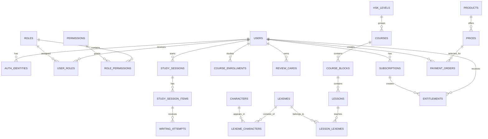

# Схема базы данных Sino

## 1. Правила модели данных

- Основной идентификатор — `UUID`, чтобы записи можно было создавать в разных
  сервисах без столкновения числовых ID.
- Все рабочие таблицы имеют `created_at`; изменяемые сущности — `updated_at`.
  Время хранится в UTC через тип `timestamptz`.
- Суммы хранятся как целые минимальные единицы в `amount_minor` и с отдельной
  валютой `RUB`; тип `float` для денег запрещён.
- Данные пользователя удаляются в два шага: статус удаления, затем очистка по
  утверждённой политике хранения.
- Сервис не отдаёт таблицу напрямую в браузер: он создаёт безопасный API-ответ.
- У учебного факта есть ссылка на источник и его лицензию.

## 2. Логические связи



## 3. Разделение БД на схемы

На старте допустим один кластер PostgreSQL. Таблицы делятся на схемы:
`identity`, `catalog`, `learning`, `billing`, `notification`, `audit`.
У каждого сервиса — своя роль БД и доступ только к собственной схеме. Если
рост потребует отдельной базы, внешний контракт сервиса не меняется.

### `identity`: пользователь, вход и роли

| Таблица | Основные поля | Ограничения |
|---|---|---|
| `users` | `id`, `email`, `display_name`, `locale`, `timezone`, `status`, `consent_version` | PK `id`; email уникален, если предоставлен и подтверждён |
| `auth_identities` | `id`, `user_id`, `provider`, `provider_subject`, `provider_email` | уникальна пара `(provider, provider_subject)` |
| `auth_sessions` | `id`, `user_id`, `refresh_token_hash`, `expires_at`, `revoked_at`, `ip_hash`, `user_agent` | хранится хеш, а не сам refresh-токен |
| `roles` | `id`, `code`, `title`, `is_system` | `code` уникален |
| `permissions` | `code`, `description` | `code` — PK |
| `user_roles` | `user_id`, `role_id`, `assigned_by`, `expires_at` | составной PK `(user_id, role_id)` |
| `role_permissions` | `role_id`, `permission_code` | составной PK |

### `catalog`: содержание HSK

| Таблица | Основные поля | Ограничения |
|---|---|---|
| `hsk_levels` | `id`, `version`, `level_number`, `title` | уникальны `(version, level_number)`; версия списка HSK обязательна |
| `courses` | `id`, `hsk_level_id`, `code`, `title`, `access_policy`, `published_at` | `code` уникален; черновик не виден учащемуся |
| `course_blocks` | `id`, `course_id`, `position`, `title` | уникальны `(course_id, position)` |
| `lessons` | `id`, `block_id`, `position`, `title`, `status`, `estimated_minutes` | уникальны `(block_id, position)` |
| `characters` | `id`, `hanzi`, `unicode_codepoint`, `script_type`, `stroke_count` | уникальны `(hanzi, script_type)` |
| `character_readings` | `id`, `character_id`, `pinyin`, `tone`, `language`, `meaning` | один иероглиф может иметь несколько чтений |
| `lexemes` | `id`, `written_form`, `pinyin`, `part_of_speech`, `hsk_level_id` | слово — отдельная сущность, не строка урока |
| `lexeme_senses` | `id`, `lexeme_id`, `language`, `meaning`, `position` | у слова может быть несколько значений/переводов |
| `lexeme_characters` | `lexeme_id`, `character_id`, `position` | уникальны `(lexeme_id, position)`; хранит порядок знаков в слове |
| `lesson_lexemes` | `lesson_id`, `lexeme_id`, `position`, `is_required` | связь конкретного урока и слова |
| `content_sources` | `id`, `name`, `url`, `license`, `retrieved_at`, `notes` | источник и лицензия учебных данных |
| `content_source_links` | `source_id`, `entity_type`, `entity_id`, `field_name` | источник конкретного факта |

### `learning`: учебный прогресс и тренировка

| Таблица | Основные поля | Ограничения |
|---|---|---|
| `course_enrollments` | `user_id`, `course_id`, `status`, `started_at`, `completed_at` | уникальны `(user_id, course_id)` |
| `lesson_progress` | `user_id`, `lesson_id`, `status`, `progress_percent`, `last_opened_at`, `completed_at` | уникальны `(user_id, lesson_id)` |
| `review_cards` | `id`, `user_id`, `content_type`, `content_id`, `due_at`, `interval_days`, `ease_factor`, `repetitions`, `state` | индекс `(user_id, due_at)` для очереди |
| `study_sessions` | `id`, `user_id`, `mode`, `lesson_id`, `status`, `started_at`, `finished_at` | контекст одной сессии |
| `study_session_items` | `id`, `session_id`, `position`, `item_type`, `target_character_id`, `status`, `server_nonce` | уникальны `(session_id, position)`; целевой символ не попадает в test API |
| `writing_attempts` | `id`, `session_item_id`, `trajectory_object_key`, `result`, `score`, `feedback_code`, `checked_at` | траектория в S3, в БД только ключ и итог |
| `daily_activity` | `user_id`, `activity_date`, `minutes_studied`, `items_completed` | уникальны `(user_id, activity_date)` |
| `achievements` | `id`, `code`, `title`, `rule_version` | описание достижения и версия правила |
| `user_achievements` | `user_id`, `achievement_id`, `earned_at`, `source_event_id` | дубль события не даёт вторую награду |

### `billing`: деньги и права доступа

| Таблица | Основные поля | Ограничения |
|---|---|---|
| `products` | `id`, `code`, `title`, `status` | продукт, например Premium |
| `prices` | `id`, `product_id`, `currency`, `amount_minor`, `period`, `active_from`, `active_to` | цена неизменяема после оплаты; новая цена — новая строка |
| `payment_orders` | `id`, `user_id`, `price_id`, `provider`, `provider_payment_id`, `amount_minor`, `currency`, `status`, `idempotence_key` | уникальны `idempotence_key` и `provider_payment_id` |
| `provider_webhook_events` | `provider_event_id`, `received_at`, `payload_encrypted`, `processed_at`, `process_result` | повтор webhook не обрабатывается второй раз |
| `subscriptions` | `id`, `user_id`, `product_id`, `status`, `started_at`, `current_period_end`, `cancel_at_period_end` | статус не вычисляется только в браузере |
| `entitlements` | `id`, `user_id`, `code`, `source_type`, `source_id`, `starts_at`, `ends_at`, `status` | Gateway проверяет право перед премиум API |
| `manual_entitlement_grants` | `id`, `entitlement_id`, `granted_by`, `reason`, `ticket_reference` | причина и администратор обязательны |

### `notification`, `audit`, `analytics`

| Таблица | Содержимое |
|---|---|
| `notification.preferences` | каналы, допустимое время, язык, согласие на напоминания |
| `notification.jobs` | отложенные задания с ключом идемпотентности |
| `notification.deliveries` | попытки доставки и ответ провайдера без секретов |
| `audit.events` | действие, исполнитель, объект, безопасное «до/после», `request_id` |
| `analytics.product_events` | обезличенное техническое событие; при росте переносится в ClickHouse |

## 4. Упрощённый SQL

Это учебная модель, а не готовая миграция. Настоящие миграции создаются
сервисом, проходят тесты и применяются в контролируемом порядке.

```sql
create table identity.users (
  id uuid primary key,
  email varchar(320) unique,
  display_name varchar(100) not null,
  locale varchar(10) not null default 'ru',
  timezone varchar(50) not null default 'Europe/Moscow',
  status varchar(20) not null check (status in ('active', 'blocked', 'deletion_pending')),
  consent_version varchar(30),
  created_at timestamptz not null default now(),
  updated_at timestamptz not null default now()
);

create table catalog.lexemes (
  id uuid primary key,
  written_form varchar(64) not null,
  pinyin varchar(128) not null,
  part_of_speech varchar(50),
  hsk_level_id uuid not null references catalog.hsk_levels(id),
  created_at timestamptz not null default now(),
  updated_at timestamptz not null default now()
);

create table catalog.lexeme_characters (
  lexeme_id uuid not null references catalog.lexemes(id),
  character_id uuid not null references catalog.characters(id),
  position smallint not null check (position > 0),
  primary key (lexeme_id, position)
);

create table learning.study_session_items (
  id uuid primary key,
  session_id uuid not null references learning.study_sessions(id),
  position smallint not null check (position > 0),
  item_type varchar(30) not null,
  target_character_id uuid references catalog.characters(id),
  status varchar(20) not null default 'pending',
  server_nonce uuid not null unique,
  created_at timestamptz not null default now(),
  unique (session_id, position)
);

create table billing.payment_orders (
  id uuid primary key,
  user_id uuid not null references identity.users(id),
  price_id uuid not null references billing.prices(id),
  provider varchar(30) not null,
  provider_payment_id varchar(100) unique,
  amount_minor integer not null check (amount_minor > 0),
  currency char(3) not null default 'RUB',
  status varchar(30) not null,
  idempotence_key uuid not null unique,
  created_at timestamptz not null default now(),
  updated_at timestamptz not null default now()
);
```

## 5. Обязательные индексы

```text
identity.auth_identities(provider, provider_subject) UNIQUE
learning.review_cards(user_id, due_at)
learning.lesson_progress(user_id, lesson_id) UNIQUE
learning.study_session_items(session_id, position) UNIQUE
billing.payment_orders(provider_payment_id) UNIQUE
billing.payment_orders(user_id, created_at DESC)
billing.entitlements(user_id, code, status, ends_at)
notification.jobs(status, scheduled_at)
audit.events(actor_user_id, created_at DESC)
```

Индекс ускоряет чтение, но замедляет запись. Каждый новый индекс добавляется
после проверки реального запроса через `EXPLAIN ANALYZE`, а не «на всякий
случай».

## 6. Права ролей БД

| Роль БД | Может читать/писать | Не может |
|---|---|---|
| `identity_app` | только `identity.*` | платежи, каталог, попытки письма |
| `catalog_app` | только `catalog.*` | пользователи и подписки |
| `learning_app` | `learning.*`, опубликованный каталог через API/проекцию | auth-сессии и платежи |
| `billing_app` | только `billing.*` | менять каталог и прогресс |
| `admin_readonly` | безопасные read-модели | секреты, raw webhook, токены |
| `migration_runner` | миграции по утверждённому окружению | не используется приложением |

## 7. Открытые технические решения

- Финальная схема SRS: SM-2-подобная модель или иной алгоритм.
- Формат траектории письма: SVG, точки с временем или бинарный формат.
- Сроки хранения попыток письма и технических логов.
- Поля, нужные выбранному оператору фискализации.
- Версии и лицензии HSK-списков, словаря и порядков черт.
